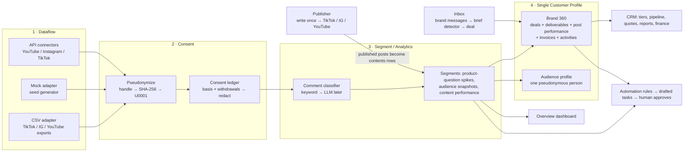
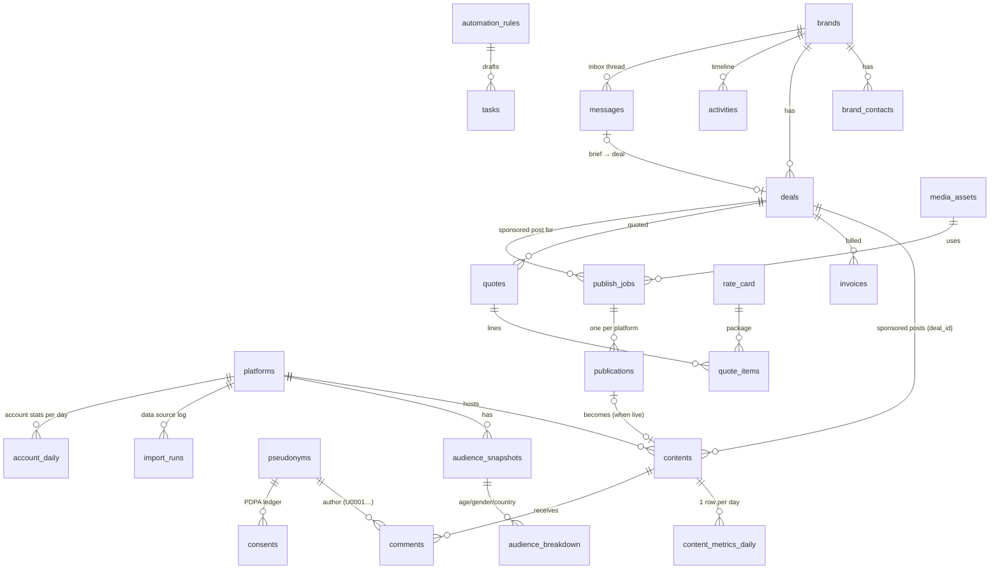

# Creator OS

A customer data platform (CDP) and CRM in one app, for influencers who work alone. Built as a class prototype.

The core idea: **a creator's real revenue comes from brands (B2B), not fans.** Deals are
scattered across LINE / DM / email and nobody follows up, so brands hire once and disappear.
Creator OS turns **One-time brands into repeat Partners**.

## What it does

| Area | What you get |
|---|---|
| **Overview** | A “Needs you today” list and the key numbers across platforms |
| **Import data** | Drop in any exports or spreadsheets at once; each one is recognised and filed in the right place |
| **Brands** | A full history per brand (Brand 360), computed tiers, a deal pipeline, quotes and performance reports |
| **Publisher** | Write one post, adjust it for TikTok, Instagram and YouTube, then publish or schedule it |
| **Inbox** | Brand messages with automatic brief detection, plus audience comments with suggested replies |
| **Audience** | Follower growth, demographics, segments, pseudonymous profiles and a printable media kit |
| **Automation** | Rules that draft follow-ups, reports and alerts for you to approve |
| **Finance** | Income, overdue invoices, a tax estimate and a CSV export |
| **Ask AI** | Answers from your own data with links to the source pages, offline or with Claude |

The app runs in two modes, and they never share a database:

| | Demo (default) | Live |
|---|---|---|
| **Data** | A seeded story with fictional brands and people | Your real accounts and imports |
| **“Today”** | Fixed at 2026-10-31 | The real date in Bangkok |
| **Database** | `data/creator-os.db` | `data/creator-os-live.db` |
| **Mock data badge** | Shown | Hidden |
| **Start with** | `npm run dev` | `npm run dev:live` ([setup](#going-live-your-real-data)) |

## Quick start

```bash
git clone https://github.com/ddmc1/creator-os.git
cd creator-os
npm install && npm run seed
./start.sh          # starts the Go API and the web app (demo mode)
# open http://127.0.0.1:3000          ·  ./stop.sh stops both
```

**macOS app icon:** double-click **Creator OS.app** (in the project folder) to start the Go API and the web app on
your real data (live mode) and open it in the browser. Double-click it again while it's running to **Open** or
**Stop** it. Drag it to the Dock if you like, but keep the app file inside this folder (it finds `start.sh` from
its own location). If it fails to start, the reason is in `.run/launcher.log`.

`./start.sh live` runs on your real data, and `./start.sh --prod` builds and runs the production servers
(see [Go API](#go-api-backend)). Requirements: Node 22+ (tested on Node 24.19, macOS) and Go 1.26+ for the API. The SQLite driver ships prebuilt binaries for macOS, Windows and Linux, so no compiler is needed. The database is a single local SQLite file at
`data/creator-os.db`; no server needed.

| Script | What it does |
|---|---|
| `./start.sh [live] [--prod]` | Starts the Go API and the web app together (logs in `.run/`); `./stop.sh` stops both |
| `npm run dev:api` / `dev:api:live` | Starts only the Go API (demo / live data) |
| `npm run test:api` | Go tests for the API |
| `npm run verify:api` | Checks the running Go API returns exactly what the TypeScript code computes from the same database |
| `npm run seed` | Rebuilds `data/creator-os.db` from scratch with the seeded story (deterministic) |
| `npm run dev` | Starts the app (demo) |
| `npm run dev:live` | Starts the app in live mode (your real data) |
| `npm run start:demo` | Production start that reseeds first (used by Render) |
| `npm run setup:live` | Creates the empty live database for your real data |
| `npm run start:live` | Production start for live mode (applies migrations first) |
| `npm run build` | Production build, needed before either production start |
| `npm run migrate` | Applies new migrations to the current database and keeps its data |
| `npm run import:workbook -- files…` | Imports your Excel workbooks into the current database |
| `npm run verify` | Checks the story on a temp copy of the DB: tiers, silent brands, spike, the exact automation tasks for the story date, inbox briefs, finance figures, audience segments and Ask AI answers |
| `npm run typecheck` | TypeScript check |
| `npm run db:generate` | Regenerate the SQL migration after editing `src/db/schema.ts` |

> ⚠️ **If you use live mode, be careful with `npm run seed`.** It also empties `data/uploads/`, which
> demo and live mode share, so it deletes your live Publisher media (`npm run start:demo` runs it too).
> It also rebuilds whichever database it points at, so never run it with `APP_MODE=live`.

**Put the demo online (free, Render):** the repo includes `render.yaml`. On render.com choose
*New → Blueprint*, pick this GitHub repository and deploy. The free plan has no permanent disk, so
`npm run start:demo` rebuilds the demo database on every start; anything changed in the app resets
when the service sleeps (after ~15 minutes idle) or redeploys. The first visit after sleeping takes
about a minute. Report links in drafted messages use Render's public URL automatically.

**Language:** the UI is English by default; the **EN → ภาษาไทย** button in the sidebar switches every
screen (stored in a `locale` cookie). Mock *data* stays Thai on purpose (fan comments, post titles,
the creator's rate card, and the messages drafted to Thai brands).

**Demo tip:** the whole story is anchored to a fixed “today” of **2026-10-31** (`src/lib/config.ts`),
so the numbers are identical on any presentation day. *Settings → Reset demo data* rebuilds the DB
between rehearsals; *Automation → Clear all tasks* clears just the tasks.

---

## Going live (your real data)

Demo mode (the default) is the seeded story. **Live mode** is the same app on your real data:
real Bangkok date, an empty database (`data/creator-os-live.db`), a password login, and your
connected accounts. The two never share a database.

1. `cp .env.example .env.local` and fill in the **Live mode** block (a password, `AUTH_SECRET`,
   `CRON_SECRET`). Leave `APP_MODE` out so `npm run dev` keeps opening the demo.
   **Always set `APP_PASSWORD`:** login is on only when it's set, in either mode, so a live app without
   it is open to anyone who can reach it. It also means the local demo asks for the password too.
   For hosting, also set your own `PSEUDONYM_SALT` before the first import, because comment authors are
   hashed with it (it isn't in `.env.example`, and the fallback is a default value in the code).
2. `npm run setup:live` creates the empty live database (it refuses to overwrite an existing one).
3. `npm run dev:live` → sign in → **Settings**: set your rate card, then **Brands → Add brand**.
4. Bring in what you already have: **Import data** (sidebar) takes any mix of files at once, see
   [One-stop import](#one-stop-import). The older forms still work: **Settings → Import your workbook (.xlsx)** reads your own Excel
   files (sheets named `TikTok_Clips`, `IG_Posts`, `TikTok_Daily`, `TikTok_Followers_Daily`,
   `TikTok_Follower_Gender/_Territories`, `IG_Audience_AgeGender/_Countries`; or
   `npm run import:workbook -- files…`). Per-post sheets hold lifetime totals, recorded on the posting
   day; `TikTok_Daily` feeds the Overview's daily chart. **Import brands & deals** takes the CSV template.
5. Connect accounts in **Settings → Connected accounts**. Each needs a developer app on that
   platform; put its id/secret in `.env.local` and register the redirect URL shown in Settings.

| Account | What comes in | Notes |
|---|---|---|
| YouTube + Gmail (one Google login) | Daily video stats, comments, audience · brand emails into the Inbox (known contacts, or new briefs) · approved email replies saved as **Gmail drafts** · **video uploads from the Publisher** | Google Cloud project with YouTube Data API, YouTube Analytics API and Gmail API enabled; add yourself as a test user. Analytics lags 2–3 days |
| Instagram | Posts, insights, comments, follower demographics · **Reels, photos and Stories from the Publisher** | Creator/Business account; demographics need ≥ 100 followers. Lifetime totals are turned into daily changes (`src/connect/totals.ts`). Add the `instagram_business_content_publish` permission to your Meta app |
| TikTok | Videos with views, likes, comments, shares · **posting from the Publisher** | Display API has no comment text or demographics: keep importing the Studio CSV for those. Add the **Content Posting API** product (Direct Post, `video.publish`) to your TikTok app |
| LINE OA | Brand chats into the Inbox; **Send via LINE** sends only when you click | Messaging API channel; set the webhook URL shown in Settings |

**Daily job:** `GET /api/cron/daily` with `Authorization: Bearer <CRON_SECRET>` syncs every account,
publishes due scheduled posts and runs the automations. Call it once a day (Vercel Cron, a server
cron, or any scheduler).

**Scheduled posts:** `GET /api/cron/publish` (same `Authorization` header) only publishes posts that are
due, so it's cheap. Call it every 5–15 minutes; otherwise a post scheduled for 18:00 waits for the next
daily job.

**Publishing for real (live mode):** the Publisher posts through your connected accounts
(`src/publish/live/*`); demo mode keeps the mock. Accounts connected before this feature have no posting
permission yet: Settings shows *No posting permission yet*, so click **Reconnect** and allow posting.
Each Publisher card says who it will post as, or why it can't. What the platforms impose:

| Platform | How it posts | Limits until your developer app is approved |
|---|---|---|
| YouTube | Resumable upload in 16 MB chunks | Uploads from a Google Cloud project that hasn't passed YouTube's API audit are locked to **Private**; the queue says so. Each upload uses a large share of the daily API quota. YouTube decides Short vs Video itself (vertical/square ≤ 3 min = Short) |
| Instagram | Container → video upload → wait for processing → publish → first comment | Images must be **JPEG** and are fetched by Instagram from a signed link (`/api/media/public/…`, valid 1 hour), so image posts need the app on a public `https` `APP_URL`; videos upload directly. The API can't set the *Paid partnership* label (turn it on in the app) and location needs a numeric place ID |
| TikTok | Direct Post, chunked upload, then status polling | Until TikTok audits your app every post is **Only me**, and branded content can't be Only me. Photo posts are pulled from a URL on a domain verified in the TikTok developer portal (public `APP_URL` needed) |

A failed platform shows its error in the queue, with **Retry failed**, which resends only the platforms
that failed. Published posts show **Open post**. Videos can take several minutes, so keep the page open
while it publishes. Connector code follows each platform's documentation at the time of writing, so check
error messages against the platform's current docs if a sync or post fails.

**Hosting live:** live mode keeps SQLite on disk, so it needs a host with a persistent disk (your
own computer, a VPS, or Oracle Cloud's free VM). Use `npm run build && npm run start:live`
(`start:live` applies new migrations first). Serverless hosts without a disk (Vercel) need the
database moved to Turso/Postgres first.

---

## Go API (`backend/`)

A Go service that owns the app's data and business rules and serves them as JSON to the frontend. It reads and
writes **the same SQLite file** as the web app (`data/creator-os.db` or `data/creator-os-live.db`, WAL mode,
pure-Go driver so no C compiler is needed). The tables still come from the Drizzle migrations
(`npm run seed` / `migrate` / `setup:live`); the API never changes the schema.

**Open `http://127.0.0.1:8080/`** for the API's front page: every endpoint with a description and a “try it”
form. (A test makes sure no endpoint is missing from that page.)

| Area (`/api/v1/…`) | Endpoints |
|---|---|
| System | `GET health`, `GET context` (status, demo/live mode, “today”) |
| Overview | `GET overview?range=7\|28\|90` · `GET today` (“Needs you today”) |
| CRM | `GET brands` · `POST brands` · `GET brands/{id}` (Brand 360 with next offer) · `GET pipeline` · `POST deals/{id}/stage` |
| Finance | `GET finance` · `GET finance/export?year=` · `POST invoices/{id}/paid` |
| Inbox | `GET inbox` · `GET inbox/threads` · `GET inbox/threads/{brandId}` · `POST inbox/threads/{brandId}/read\|reply` · `GET inbox/comments` · `POST messages/{id}/convert\|ignore` · `POST comments/{id}/reply\|hide` |
| Audience | `GET audience` · `GET audience/segments/{id}/members` · `GET audience/members/{pseudoId}` |
| Automation | `GET automation` · `POST automation/rules/{id}/enabled` · `POST automation/reset` · `POST tasks/{id}/complete\|dismiss` |
| Settings | `GET settings` · `PUT settings/rates` · `PUT settings/profile` |

The frontend calls it from server code only (`src/lib/api.ts`). **On Go now:** Overview, Brands, Brand 360,
Pipeline, Finance, Inbox, Audience, Automation (everything after a task is drafted) and the Settings profile,
rate card, import history and consent summary, plus the actions on those pages.

**Still in Next.js** (reads/writes the same database directly): the rules that *create* automation tasks
(they own the Thai message templates and the drafting), Publisher, One-stop Import and CSV/workbook imports,
connected-account logins (OAuth tokens), Ask AI, the print pages (media kit, report, quote), and
sending (Gmail drafts, LINE messages).

- **Same rules, one source:** the Go code is a port of `src/crm/*`, `src/cdp/crossPost.ts` and
  `src/lib/queries/*`. `npm run verify:api` compares the two on whatever database you run it against
  (Overview in 3 ranges, today list, brands, every Brand 360 incl. the next offer in English and Thai, pipeline,
  finance, CSV, the Inbox, Audience, Automation and Settings reads) and fails on any difference.
- **Settings:** the API reads `.env.local` too. `API_PORT` (8080), `API_URL` (where the frontend looks),
  `API_TOKEN` (optional shared secret: set it on both sides if the API is ever reachable beyond this computer;
  without a token the API only accepts local connections and refuses to listen elsewhere).
- **Live mode:** `APP_MODE=live` (done by `./start.sh live` / `npm run dev:api:live`) uses the live database
  and the real Bangkok date.
- **Layout:** `cmd/server` (main), `internal/api` (HTTP), `internal/crm` (tiers, finance, writes),
  `internal/overview`, `internal/today`, `internal/cdp` (cross-post grouping, spikes), `internal/inbox`,
  `internal/audience`, `internal/automation`, `internal/settings`, `internal/brand360` (post performance, next offer),
  `internal/store` (database, clock). Tests use a throwaway database built from the project's own migrations.

---

## MCP server (`mcp/`) — for external AI

An [MCP](https://modelcontextprotocol.io) server that lets an outside AI (Claude Desktop, Claude Code, Cursor…)
read your Creator OS data. It is a thin layer over the Go API, so the Go API must be running (`./start.sh`).
It talks over stdio and starts on demand: you don't run it yourself.

**Read-only by default (17 tools):** `get_context`, `get_today`, `get_overview`, `list_brands`, `get_brand`,
`get_pipeline`, `get_finance`, `export_income_csv`, `get_inbox`, `list_inbox_threads`, `get_inbox_thread`,
`list_comments`, `get_audience`, `list_segment_members`, `get_audience_member`, `get_automation`, `get_settings`.

**Writes are opt-in:** set `CREATOR_OS_MCP_WRITE=1` to add `create_brand`, `move_deal_stage` and
`mark_invoice_paid`. Sending anything to a brand or fan (inbox and comment replies, completing automation tasks),
changing settings and account credentials are never exposed: those stay in the app.

Add it to your AI app's MCP config (use the absolute path to this folder):

```json
{
  "mcpServers": {
    "creator-os": {
      "command": "npm",
      "args": ["--silent", "--prefix", "/absolute/path/to/Creator OS", "run", "mcp"],
      "env": { "CREATOR_OS_API_URL": "http://127.0.0.1:8080" }
    }
  }
}
```

Claude Code: `claude mcp add creator-os -- npm --silent --prefix "/absolute/path/to/Creator OS" run mcp`.
Settings: `CREATOR_OS_API_URL` (default `http://127.0.0.1:8080`), `CREATOR_OS_API_TOKEN` (the Go API's `API_TOKEN`, if set),
`CREATOR_OS_MCP_WRITE`. Whichever database the Go API runs on (demo or live) is what the AI sees, so in live mode
it can read your real brands, invoices and audience: only connect AI apps you trust with that.

---

## Architecture — the 4 CDP stages

The CDP is the single source that both the **data side** and the **marketing/sales side** work from.



| Stage | Code |
|---|---|
| 1. Dataflow | `src/cdp/adapters/PlatformAdapter.ts` (interface), `adapters/csv/CsvAdapter.ts`, `adapters/mock/*`, `src/cdp/ingest.ts` (runs an adapter end-to-end and logs an `import_runs` row), `src/cdp/adapters/workbook/importWorkbook.ts` (Excel import), `src/connect/*` (account connections and sync) |
| 2. Consent | `src/cdp/pseudonymize.ts`, `src/cdp/consent.ts` (`registerAnalyticsBasis`, `applyConsent`, `ANALYTICS_OK` filter) |
| 3. Segment / Analytics | `src/cdp/classify/*` (classifier interface + keyword rules), `src/cdp/segments.ts` (spikes, audience), `src/crm/contentPerformance.ts`, `src/lib/queries/overview.ts` |
| 4. Single Customer Profile | Brands: `src/crm/brandStats.ts` + `src/app/(app)/brands/[id]/page.tsx` (Brand 360). Audience: `src/cdp/profiles.ts` (`audienceProfile`) + `/audience?member=U0108` |
| Inbox | `src/inbox/*` (brief detector, thread + comment queries, suggested replies), `src/app/(app)/inbox/page.tsx` |
| Finance | `src/crm/finance.ts`, `src/app/(app)/finance/page.tsx`, `src/app/api/finance/export/route.ts` (CSV) |
| Ask AI | `src/ai/*` (facts, `Assistant` interface, offline `RuleAssistant`, optional `ClaudeAssistant`), `src/app/(app)/ask-ai/page.tsx` |
| Outbound: Publisher | `src/publish/*` (types, per-platform rules, `PlatformPublisher`, `MockPublisher`, `publishers.ts` picks mock vs API, `live/*` YouTube / Instagram / TikTok, service), `src/app/api/media/route.ts` (upload), `src/app/api/media/public/[token]/route.ts` (signed links platforms fetch), `src/app/api/cron/publish/route.ts`, `src/app/(app)/content/page.tsx` |

Stack: Next.js 16 (App Router, Server Components + Server Actions) · TypeScript · Tailwind v4 ·
SQLite via better-sqlite3 + Drizzle ORM · Recharts. Fonts: Kanit (headings) + IBM Plex Sans Thai (body).

**Traceability:** components never contain figures. Every number on Overview and Brand 360 is
computed at request time from DB rows (`src/lib/queries/*`, `src/crm/*`). The daily `comments`
metric equals the count of comment rows for that post and day; monthly follower snapshots
equal the starting count plus the summed `new_followers`.

---

## Content Publisher (one click, every platform)

*Publisher* in the sidebar (`/content`):

1. **Media:** upload one video or image. It's stored in `data/uploads/` on this computer only. Duration, size and orientation are read in the browser.
2. **Main post:** caption, hashtags, content type and product category (for the CDP), and an optional link to a brand deal.
3. **Platforms:** turn each one on or off. Any platform can **override the caption** and set its own options:

| TikTok | Instagram | YouTube |
|---|---|---|
| who can view · allow comments / Duet / Stitch · branded-content label · photo mode for images | Reel / Feed / Story · share Reel to feed · first comment · collaborator · location · paid-partnership label | title · description · tags · Short / Video · visibility · made for kids · category · paid-promotion flag |

4. **Live checks + preview** (`src/publish/rules.ts`, the same code runs in the browser and on the server):
   caption length per platform, Instagram hashtag cap, YouTube title rules, tags length, hashtag overload,
   image not allowed on YouTube, video length per format, Shorts orientation, captions hidden on Stories,
   TikTok branded content can't be "Only me".
   The limits are **prototype values** — confirm them against each platform's current docs before going live.
5. **Publish now** (demo: the simulated story date; live: right away) or **schedule**. Scheduled posts are
   published by the daily 10:00 automation run in demo mode, and by `/api/cron/publish` in live mode
   (or "Publish now" in the queue).

Linking a deal forces the disclosure labels on (and optionally adds `#ad`). When the post goes live, each
platform's post is written to `contents` (so it appears in the CDP and Brand 360), and the deal moves to
**Posted**, which arms the +7 / +30 report rules.

**Real publishing:** in live mode `getPublisher()` (`src/publish/publishers.ts`) returns the API publisher for
each connected platform: `YouTubePublisher`, `InstagramPublisher` and `TikTokPublisher` in `src/publish/live/`,
all implementing `PlatformPublisher` (`src/publish/types.ts`). Live mode never falls back to the mock: a
platform that isn't connected fails with a message saying what to do. See
[Publishing for real](#going-live-your-real-data) for each platform's limits. When the accounts sync later,
posts made here keep the type, category and deal you picked.

---

## One-stop import

*Import data* in the sidebar (`/import`). Drop every file you have: TikTok / Instagram / YouTube exports,
your own spreadsheets, your Creator OS workbook. CSV, TSV and Excel (.xlsx), several at once.

1. **Read** (`src/import/read.ts`): one table per CSV or Excel sheet. The header row is found even under a
   title line; UTF-16 and tab/semicolon files work.
2. **Recognise** (`src/import/detect.ts`, offline): column names in English, Thai, platform export names
   and the workbook's own names decide what each table is (posts, comments, daily account stats, audience
   by age / gender / country, brands & deals) and which column means what; the values are checked, and
   the platform comes from file names, links and platform-only columns.
3. **AI, only when unsure** (`src/import/claudeDetect.ts`): with `ANTHROPIC_API_KEY` set, a table the
   built-in step isn't sure about is shown to Claude: column names plus 3 sample rows, with names /
   usernames / emails replaced by `<person>`. Never whole files. Every value in the answer is checked.
4. **Import** (`src/import/load.ts`): sure → imported straight away through the existing pipelines (ingest,
   `account_daily`, the brands & deals importer, the workbook importer). Not sure → waits on the page
   with its best guess: confirm what it is, the platform, or the column for a missing field, or skip it.
   Re-importing a newer export updates the numbers instead of duplicating posts.

Dates: Thai Buddhist years (2569) are converted, and each column is read day-first or month-first from
its values (Instagram/Meta exports default to month-first). Audience files only replace their own split
(a gender file keeps the month's age and country). Uploads are kept in `data/import/batches/` (git-ignored,
removed after a day) so a waiting file can be imported without uploading it again.

---

## Inbox, Audience, Finance, Ask AI

**Inbox** (`/inbox`)
- *Brand messages*: one thread per brand (seeded LINE OA / IG DM / email in demo mode; Gmail and LINE
  once connected in live mode). Every inbound message goes
  through a **brief detector** (`src/inbox/briefDetector.ts`, keyword rules behind a `BriefDetector`
  interface, the same swap pattern as the comment classifier). It pulls out budget, platforms, timing and product.
  **Create deal** turns a detected brief into a deal at *Brief* (value = budget, or the rate-card price
  of the guessed deliverables) and logs it on the brand timeline. Replies come pre-drafted; *Mark as sent*
  adds them to the thread and timeline. Sending is simulated in demo mode; in live mode, email replies are
  saved as Gmail drafts and LINE replies send only when you click. Approved automation drafts to a
  brand also show up in its thread.
- *Audience comments*: last 14 days of consented comments, product questions first, filterable by
  category, platform and status, each with a suggested Thai reply. *Copy & mark replied* / *Hide* only
  change the status here; the creator posts the reply on the platform.

**Audience** (`/audience`)
- Followers per platform with 12-month growth, a follower growth chart, and age / gender / country
  for any month and platform.
- **Segments** from consented comments in the last 90 days (mostly-spam accounts excluded): superfans
  (≥ 5 comments), content requesters, new this month, newsletter opt-ins (the only contactable group),
  and “asked about <category>” per product category (the spiking one is flagged).
- Click a segment to list its members, then a pseudo ID for the **audience profile** (single customer
  profile): first/last seen, platforms, consent rows, interests, comment mix and comments. A person who
  withdrew consent shows only that their data was excluded.
- **Media kit** (`/print/media-kit`): built from live data every time you open it, ready to print or save as PDF for brands.

**Finance** (`/finance`), with rules in `src/crm/finance.ts`
- Income is **cash basis** (invoice `paid_at`). Outstanding = unpaid invoices; overdue = unpaid past
  `due_at`. Expected = won deals not yet invoiced.
- Monthly income chart, receivables ageing, income by brand and by platform (each invoice split across its
  deliverables by rate-card price; bundles expand to their parts).
- *Mark as paid* moves the deal to **Paid** (same as the pipeline, so tiers and the timeline update).
- **Tax summary (estimate)**: gross, 3% withholding (typical for Thai company payers), net, plus a
  CSV export per year for the accountant. It's an estimate, not tax advice.

**Ask AI** (`/ask-ai`)
- `gatherFacts()` reads everything the assistant may use from the DB: brands, offers, invoices, finance,
  top content, product-question trends, audience totals and segment sizes, inbox threads, open tasks.
  It contains aggregates, brand names, deal and invoice figures, and a preview of each listed brand thread's
  latest message (up to 160 characters). It has **no audience comment text and no pseudo IDs**.
- **Offline by default:** `RuleAssistant` matches the question (English or Thai) to a topic and answers
  from the facts, with **source links** to the pages the numbers come from.
- **Optional Claude:** set `ANTHROPIC_API_KEY` (e.g. in `.env.local`) and restart. `ClaudeAssistant`
  sends the same facts to `claude-opus-5-5` (low effort, server-side refusal fallback turned on) and asks
  it to cite source ids. If the call fails, the app answers offline instead and says so.
  **In live mode these facts are real:** setting the key sends your real brand names, money figures and
  message previews to Anthropic. Leave it unset to keep Ask AI fully offline.

---

## Data model



| Table | Purpose |
|---|---|
| `platforms` | tiktok, instagram, youtube |
| `contents` | one row per post: platform, type (review/tutorial/vlog/bts), product category, posted_at, is_sponsored, deal_id |
| `content_metrics_daily` | daily views, likes, comments, shares, saves, profile_views, new_followers per post |
| `audience_snapshots` + `audience_breakdown` | monthly followers + demographics per platform |
| `pseudonyms` | salted hash of a handle → pseudo ID. **Real usernames are never stored.** |
| `comments` | pseudo author, text, category, classifier name, `redacted` flag, reply status / text (Inbox) |
| `consents` | subject × purpose, lawful basis, status, withdrawn_at |
| `brands`, `brand_contacts` | brands and their contacts (fictional in demo mode, real in live mode) |
| `deals` | stage, value (THB), deliverables (rate-card codes), created/posted/closed dates |
| `invoices` | amount, issued/due/paid dates |
| `activities` | brand timeline (brief, quote, draft, revision, posted, report, invoiced, paid, call, chat) |
| `rate_card`, `quotes`, `quote_items` | packages, prices, generated quotes |
| `automation_rules`, `tasks`, `automation_runs` | rules config, drafted tasks (unique `dedupe_key`), run log |
| `import_runs` | last import status per platform (Settings → Data Sources) |
| `media_assets`, `publish_jobs`, `publications` | Publisher: uploaded file, the write-once post, and its per-platform caption/options/status, error, platform notes and link to the live post |
| `messages` | Inbox: brand thread messages (in/out, channel), detected brief (JSON), brief status, linked deal, source task, external message ID (for connected accounts) |
| `connections` | one row per connected account: encrypted tokens, scopes, last sync and last error |
| `metric_totals` | latest lifetime totals per post, used to turn platform totals into daily changes |
| `account_daily` | account-level daily stats per platform (views, followers and more) |
| `app_settings` | key/value settings: `story_date` (demo mode) and your profile |

---

## Business rules

All definitions live in one place: `src/crm/rules.ts`.

### Brand tiers (computed, never stored)
Count deals at stage **Paid** with `closed_at` in the 365 days ending today:

| Tier | Rule |
|---|---|
| Partner | ≥ 3 paid deals in 12 months |
| Repeat | 2 |
| One-time | 1 |
| Lead | 0 (includes brands whose only paid work is older than 12 months) |

Other definitions: **won deal** = stage Production or later · **deal value this year** = Σ won deals
created in the current calendar year · **jobs** = # won deals · **LTV** = Σ won deals ·
**avg deal size** = LTV ÷ jobs · **days since last job** = today − latest `posted_at` ·
**silent** = has a won deal, no open deal, no activity for ≥ 120 days ·
**engagement rate** = (likes + comments + shares + saves) ÷ views ·
**+N days** = cumulative metrics for posting day … day N−1 (shown once today ≥ posted + N).

### Recommended next offer (`src/crm/nextOffer.ts`, first match wins, reason shown)
1. Lead (never won) → TikTok video starter
2. Silent ≥ 120 days → their last package, with follower growth since then
3. Partner → quarterly retainer
4. Bought a single platform only and their sponsored ER ≥ creator's sponsored median → 3-platform bundle
5. ≥ 8 product questions per sponsored post → YouTube dedicated review
6. Otherwise → last package + usage-rights add-on

### Automation rules (`src/automation/*`)
Run on demand (*Automation → Run automations*) for any simulated date, as if a cron ran at 10:00. In live
mode, the [daily job](#going-live-your-real-data) runs them for the real date.
Each rule creates a **Task with a drafted message**. Nothing is sent automatically: a human edits, copies,
and approves (approval logs an activity on the brand timeline; approving a +7 report also moves
a Posted deal to Report Sent). Re-running a date is idempotent (`tasks.dedupe_key`).

| Rule | Trigger | Output | Dedupe |
|---|---|---|---|
| `post_plus_7` | sponsored post went live exactly 7 days ago | +7 performance report draft to brand (email) | deal |
| `post_plus_30` | … exactly 30 days ago | +30 report + follow-up proposal from next-offer rules | deal |
| `brand_silent_120` | silent brand (see above) | re-engagement message with latest audience stats (LINE) | brand + last activity date |
| `invoice_overdue_30` | unpaid and ≥ 30 days past due | internal reminder with a polite chaser inside | invoice |
| `pq_spike` | product-question comments in a product category, last 7 days ≥ 3× the daily average of the previous 28 days, and ≥ 20 | internal alert: “pitch brands in this category” + example questions + brand list | category + ISO week |

### The seeded story (expected tasks for 2026-10-31)
| Story element | Data |
|---|---|
| 1 Partner | **Glowberry Skin**, 4 paid deals in 12 months |
| One-time brands silent > 120 days | **Sunday Brew** (185 d), **Lumi Lens** (150 d), **Daisy Thread** (130 d) |
| Overdue invoice | **Pixel Pal** INV-0011, 35 days past due |
| Product-question spike | **tech**, ~8× the baseline in the last 7 days |
| +7 / +30 posts | **Nook Home** posted 2026-10-24 · **Glowberry** posted 2026-10-01 |
| New briefs in the Inbox | **Kumo Audio** (Kumo Air 2, ฿40,000, TikTok + YouTube) · **Fresh Leaf** (Matcha Yuzu, ฿20,000, TikTok) |
| Other unread messages | Pixel Pal promises to pay next week · Aroma Lab asks for a discount · Cloud Nine sent a sample · Zesty Kitchen is checking the quote |

Running automations for 2026-10-31 → **7 tasks**: 1× +7 report, 1× +30 report + proposal,
3× re-engagement, 1× invoice reminder, 1× tech spike alert. `npm run verify` asserts this.

Seed volume: 3 platforms · 120 days · ~150 posts in the window (plus older sponsored posts with
their first 30 days of metrics) · ~3,150 comments · 15 brands · 35 deals across all 8 stages · matching invoices.

---

## How to add another platform adapter

YouTube, Instagram and TikTok connectors already exist in `src/connect/`, and `src/connect/youtube.ts` is a
good example to follow. For a new platform (“Example” below):

1. **Implement the interface** in a new file such as `src/connect/example.ts`:
   ```ts
   export class ExampleApiAdapter implements PlatformAdapter {
     readonly kind = "api" as const;
     readonly platform = "example" as const; // add it to PlatformId and the platforms table first
     constructor(private token: string, private since: string) {}
     async importContents()  { /* GET videos → RawContent[] (externalId = video id) */ }
     async importMetrics()   { /* daily insights → RawMetricDaily[] (daily deltas, not totals) */ }
     async importComments()  { /* comments → RawComment[] (raw handle is fine — ingest pseudonymizes) */ }
     async importAudience()  { /* follower demographics → RawAudienceSnapshot[] */ }
   }
   ```
2. **Run it through ingest**: `await ingest(db, new ExampleApiAdapter(token, since), now)`. Ingest
   upserts by `(platform, external_id)` and `(content_id, date)`, classifies comments, pseudonymizes
   authors, applies consent and writes an `import_runs` row, so Settings → Data Sources shows it.
3. **Schedule it**: add it to `syncAll()` in `src/connect/sync.ts`. The daily job (`/api/cron/daily`) calls
   that, then runs the automations.
4. **Keep the rules**: content type / product category aren't exported by platforms; set them via
   the creator's tagging (the CSV adapter reads `Type`, `Category`, `Sponsored` columns) or an LLM tagger.
5. **Link sponsored posts to deals**: API data has no `deal_id`; add a “link to deal” control on the
   content library (not built yet; posts made in the Publisher are already linked).

**Swap the comment classifier for an LLM:** implement `CommentClassifier.classifyBatch()` in
`src/cdp/classify/` and return it from `getClassifier()`. Nothing else changes; the classifier name is
stored per comment so you can compare old and new labels.

**Languages:** all UI strings live in `src/lib/i18n/en.ts` and `th.ts` (same shape, type-checked).
Server components use `await getI18n()`, client components `useI18n()`. Generated data (task drafts,
timeline notes) uses `dataT` (Thai). Tasks also store raw `vars`, so their titles and reasons render in
the current UI language while the drafted message stays Thai.

---

## Privacy (PDPA)

- No real usernames anywhere: handles from imports are hashed (SHA-256 + salt) at ingest and replaced by
  `U0001…`. Only the hash is stored. Sample CSVs use obviously fake handles.
- Public comments on the creator's own posts are processed under *legitimate interest* for content
  analytics only; each subject gets an `analytics` row in `consents` on first sight.
- Withdrawal/objection → comment text is wiped (`redacted`) and excluded from every analytic (`ANALYTICS_OK`).
- Direct marketing requires separate *consent* (`marketing` purpose, e.g. newsletter form).
- Brand contacts in the seed are fictional and labelled “(สมมติ)”.
- **Live mode holds real data.** Your databases, `.env.local`, uploads and `data/import/` are gitignored and stay
  on your computer. Connected-account tokens are stored encrypted (AES-256-GCM, with the key derived from `AUTH_SECRET`).
- Brand names, contacts and message text are stored as they are (only audience handles are pseudonymized).
  See [Ask AI](#inbox-audience-finance-ask-ai) for what leaves the app when a Claude key is set.

---

## What is mocked vs real

“Mocked” below describes demo mode. In live mode that data comes from your own accounts and imports.

| Area | Status |
|---|---|
| Platform data (posts, metrics, comments, audience) | **Mocked**: deterministic generator in `src/cdp/adapters/mock/`, but it flows through the **real** ingest pipeline |
| CSV import | **Real** parser + ingest (formats modelled on TikTok Studio / IG Insights / YouTube Studio exports, plus 3 tagging columns); sample files in `data/samples/` |
| Excel workbook import | **Real**: reads your own `.xlsx` files (Settings or `npm run import:workbook`) |
| Publishing to platforms | **Simulated** by `MockPublisher` (fake post IDs, nothing leaves the machine). Upload, per-platform customization, validation, scheduling, CDP write-back and the deal → Posted move are **real** |
| UI languages | **Real**: English + Thai, switchable at runtime |
| Pseudonymization, consent ledger, redaction | **Real** logic (salt is a local default; set `PSEUDONYM_SALT` in production) |
| Comment classification | **Real** keyword rules; LLM swap point ready. Agreement with the mock's intended labels is 100% because the mock uses clean templates. Expect lower accuracy on real comments. |
| Tiers, Brand 360, next offer, pipeline, quotes, reports | **Real** logic over the (mock) DB |
| Automation engine | **Real** rules + drafts; in demo mode the 10:00 cron is **simulated** by a button + date picker; nothing is sent automatically |
| “AI Insight” | **Rule-based**, not an LLM |
| Brands, contacts, deals, invoices | **Mocked** (fictional) |
| Brand inbox messages | **Mocked** (seeded threads) with **simulated** sending in demo mode; Gmail and LINE can connect in live mode, but Instagram DMs can't. Brief detection, deal creation, read state and reply logging are **real** |
| Comment replies | Status + reply text are **real** (stored); posting the reply to the platform is manual |
| Audience segments, profiles, media kit | **Real** logic over the (mock) CDP data |
| Finance | **Real** rollups over the (mock) invoices; the tax figures are an **estimate** (flat 3% withholding) |
| Live mode, login, daily job | **Real**: password login, real date, empty database, `/api/cron/daily` |
| Account connections (YouTube, Gmail, Instagram, TikTok, LINE) | **Real** code paths (OAuth, sync, webhooks), tested end to end with simulated LINE events and a mock OAuth redirect; **not yet run against your live accounts** |
| Ask AI | **Real**, offline rule-based answers grounded in DB facts. **Optional real LLM** (Claude) when `ANTHROPIC_API_KEY` is set; not tested with a live key in this build |
| Multi-user | Not built: one user, one shared password |

## Project structure

```
src/
  app/(app)/…         pages: overview, content (publisher), inbox, audience, brands (list, [id], pipeline, quotes/new), automation, finance, ask-ai, settings
  app/login/          password login page
  app/print/…         printable quote, performance report, media kit
  app/api/…           media upload, finance CSV export, brands & deals template, account connections, daily job, LINE webhook
  app/actions.ts      server actions (pipeline, quotes, automation, inbox, finance, Ask AI, imports, connections, demo reset)
  proxy.ts            login check for every page and API
  ai/                 Ask AI: facts, Assistant interface, rule-based + Claude engines
  connect/            account connections: YouTube, Gmail, Instagram, TikTok, LINE, token storage, sync
  inbox/              brief detector, inbox queries, suggested replies
  cdp/                adapters (CSV, Excel workbook, mock), ingest, pseudonymize, consent, classify, segments, profiles (audience segments + profile)
  crm/                rules, brandStats, contentPerformance, nextOffer, deliverables, finance, brands & deals import
  automation/         engine + rules/* + present.ts (task text per UI language)
  publish/            publisher types, platform rules, MockPublisher, service
  components/         UI: charts, inbox, publisher, settings, layout
  db/                 Drizzle schema + client
  seed/               story fixtures + seedDatabase()
  lib/                auth, clock, config, constants, dates, format, i18n (en/th + server/client helpers), queries
scripts/              seed, setup-live, migrate, import-workbook, verify-story
drizzle/              SQL migrations
data/samples/         sample CSV exports
data/uploads/         publisher media (gitignored, cleared by npm run seed)
data/import/          your own workbooks (gitignored)
data/*.db             demo and live databases (gitignored)
```
