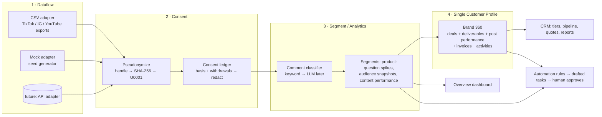
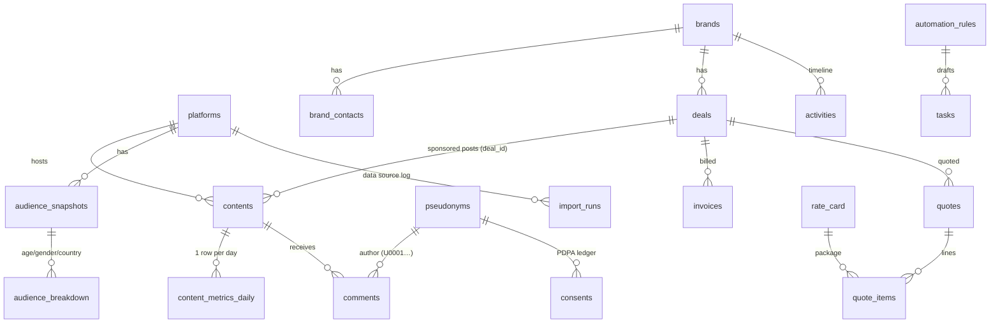

# Creator OS — CDP + CRM for solo influencers (prototype)

A class prototype of an AI-assisted operating system for creators who work alone.
The core idea: **a creator's real revenue comes from brands (B2B), not fans.** Deals are
scattered across LINE / DM / email and nobody follows up, so brands hire once and disappear.
Creator OS turns **One-time brands into repeat Partners**.

> ⚠️ All data is **mock data** generated by `npm run seed`. No real platform APIs, no real people.
> Every screen carries a “ข้อมูลจำลอง” (Mock data) badge.

## Quick start

```bash
npm install && npm run seed && npm run dev
# open http://localhost:3000
```

Requirements: Node 20+ (tested on Node 24). The database is a single local SQLite file at
`data/creator-os.db`; no server needed.

| Script | What it does |
|---|---|
| `npm run seed` | Rebuilds `data/creator-os.db` from scratch with the seeded story (deterministic) |
| `npm run dev` | Starts the app |
| `npm run verify` | Checks the story on a temp copy of the DB: tiers, silent brands, spike, and that automations for the story date produce exactly the expected tasks |
| `npm run typecheck` | TypeScript check |
| `npm run db:generate` | Regenerate the SQL migration after editing `src/db/schema.ts` |

**Demo tip:** the whole story is anchored to a fixed “today” of **2026-10-31** (`src/lib/config.ts`),
so the numbers are identical on any presentation day. *Settings → รีเซ็ตข้อมูลเดโม* rebuilds the DB
between rehearsals; *Automation → ล้างงานทั้งหมด* clears just the tasks.

---

## Architecture — the 4 CDP stages

The CDP is the single source that both the **data side** and the **marketing/sales side** work from.



| Stage | Code |
|---|---|
| 1. Dataflow | `src/cdp/adapters/PlatformAdapter.ts` (interface), `adapters/csv/CsvAdapter.ts`, `adapters/mock/*`, `src/cdp/ingest.ts` (runs an adapter end-to-end and logs an `import_runs` row) |
| 2. Consent | `src/cdp/pseudonymize.ts`, `src/cdp/consent.ts` (`registerAnalyticsBasis`, `applyConsent`, `ANALYTICS_OK` filter) |
| 3. Segment / Analytics | `src/cdp/classify/*` (classifier interface + keyword rules), `src/cdp/segments.ts` (spikes, audience), `src/crm/contentPerformance.ts`, `src/lib/queries/overview.ts` |
| 4. Single Customer Profile | `src/crm/brandStats.ts` + `src/app/(app)/brands/[id]/page.tsx` (Brand 360) |

Stack: Next.js 16 (App Router, Server Components + Server Actions) · TypeScript · Tailwind v4 ·
SQLite via better-sqlite3 + Drizzle ORM · Recharts. Fonts: Kanit (headings) + IBM Plex Sans Thai (body).

**Traceability:** components never contain figures. Every number on Overview and Brand 360 is
computed at request time from DB rows (`src/lib/queries/*`, `src/crm/*`). The daily `comments`
metric equals the count of comment rows for that post and day; monthly follower snapshots
equal the starting count plus the summed `new_followers`.

---

## Data model



| Table | Purpose |
|---|---|
| `platforms` | tiktok, instagram, youtube |
| `contents` | one row per post: platform, type (review/tutorial/vlog/bts), product category, posted_at, is_sponsored, deal_id |
| `content_metrics_daily` | daily views, likes, comments, shares, saves, profile_views, new_followers per post |
| `audience_snapshots` + `audience_breakdown` | monthly followers + demographics per platform |
| `pseudonyms` | salted hash of a handle → pseudo ID. **Real usernames are never stored.** |
| `comments` | pseudo author, text, category, classifier name, `redacted` flag |
| `consents` | subject × purpose, lawful basis, status, withdrawn_at |
| `brands`, `brand_contacts` | fictional brands/contacts |
| `deals` | stage, value (THB), deliverables (rate-card codes), created/posted/closed dates |
| `invoices` | amount, issued/due/paid dates |
| `activities` | brand timeline (brief, quote, draft, revision, posted, report, invoiced, paid, call, chat) |
| `rate_card`, `quotes`, `quote_items` | packages, prices, generated quotes |
| `automation_rules`, `tasks`, `automation_runs` | rules config, drafted tasks (unique `dedupe_key`), run log |
| `import_runs` | last import status per platform (Settings → Data Sources) |
| `app_settings` | `story_date` |

---

## Business rules

All definitions live in one place: `src/crm/rules.ts`.

### Brand tiers (computed, never stored)
Count deals at stage **Paid** with `closed_at` in the 365 days ending today:

| Tier | Rule |
|---|---|
| Partner | ≥ 3 paid deals in 12 months |
| Repeat | 2 |
| One-time | 1 |
| Lead | 0 (includes brands whose only paid work is older than 12 months) |

Other definitions: **won deal** = stage Production or later · **deal value this year** = Σ won deals
created in the current calendar year · **jobs** = # won deals · **LTV** = Σ won deals ·
**avg deal size** = LTV ÷ jobs · **days since last job** = today − latest `posted_at` ·
**silent** = has a won deal, no open deal, no activity for ≥ 120 days ·
**engagement rate** = (likes + comments + shares + saves) ÷ views ·
**+N days** = cumulative metrics for posting day … day N−1 (shown once today ≥ posted + N).

### Recommended next offer (`src/crm/nextOffer.ts`, first match wins, reason shown)
1. Lead (never won) → TikTok video starter
2. Silent ≥ 120 days → their last package, with follower growth since then
3. Partner → quarterly retainer
4. Bought a single platform only and their sponsored ER ≥ creator's sponsored median → 3-platform bundle
5. ≥ 8 product questions per sponsored post → YouTube dedicated review
6. Otherwise → last package + usage-rights add-on

### Automation rules (`src/automation/*`)
Run on demand (*Automation → รันออโตเมชัน*) for any simulated date, as if a cron ran at 10:00.
Each rule creates a **Task with a drafted message**. Nothing is ever sent: a human edits, copies,
and approves (approval logs an activity on the brand timeline; approving a +7 report also moves
a Posted deal to Report Sent). Re-running a date is idempotent (`tasks.dedupe_key`).

| Rule | Trigger | Output | Dedupe |
|---|---|---|---|
| `post_plus_7` | sponsored post went live exactly 7 days ago | +7 performance report draft to brand (email) | deal |
| `post_plus_30` | … exactly 30 days ago | +30 report + follow-up proposal from next-offer rules | deal |
| `brand_silent_120` | silent brand (see above) | re-engagement message with latest audience stats (LINE) | brand + last activity date |
| `invoice_overdue_30` | unpaid and ≥ 30 days past due | internal reminder with a polite chaser inside | invoice |
| `pq_spike` | product-question comments in a product category, last 7 days ≥ 3× the daily average of the previous 28 days, and ≥ 20 | internal alert: “pitch brands in this category” + example questions + brand list | category + ISO week |

### The seeded story (expected tasks for 2026-10-31)
| Story element | Data |
|---|---|
| 1 Partner | **Glowberry Skin**, 4 paid deals in 12 months |
| One-time brands silent > 120 days | **Sunday Brew** (185 d), **Lumi Lens** (150 d), **Daisy Thread** (130 d) |
| Overdue invoice | **Pixel Pal** INV-0011, 35 days past due |
| Product-question spike | **tech**, ~8× the baseline in the last 7 days |
| +7 / +30 posts | **Nook Home** posted 2026-10-24 · **Glowberry** posted 2026-10-01 |

Running automations for 2026-10-31 → **7 tasks**: 1× +7 report, 1× +30 report + proposal,
3× re-engagement, 1× invoice reminder, 1× tech spike alert. `npm run verify` asserts this.

Seed volume: 3 platforms · 120 days · ~150 posts in the window (plus older sponsored posts with
their first 30 days of metrics) · ~3,150 comments · 15 brands · 35 deals across all 8 stages · matching invoices.

---

## How to add a real platform adapter later

1. **Implement the interface** in `src/cdp/adapters/api/TikTokApiAdapter.ts`:
   ```ts
   export class TikTokApiAdapter implements PlatformAdapter {
     readonly kind = "api" as const;
     readonly platform = "tiktok" as const;
     constructor(private token: string, private since: string) {}
     async importContents()  { /* GET videos → RawContent[] (externalId = video id) */ }
     async importMetrics()   { /* daily insights → RawMetricDaily[] (daily deltas, not totals) */ }
     async importComments()  { /* comments → RawComment[] (raw handle is fine — ingest pseudonymizes) */ }
     async importAudience()  { /* follower demographics → RawAudienceSnapshot[] */ }
   }
   ```
2. **Run it through ingest**: `await ingest(db, new TikTokApiAdapter(token, since), now)`. Ingest
   upserts by `(platform, external_id)` and `(content_id, date)`, classifies comments, pseudonymizes
   authors, applies consent and writes an `import_runs` row, so Settings → Data Sources shows it.
3. **Schedule it**: call it from a real cron (e.g. a route handler + Vercel Cron / system cron),
   then call `runAutomations(db, today)` at 10:00.
4. **Keep the rules**: content type / product category aren't exported by platforms; set them via
   the creator's tagging (the CSV adapter reads `Type`, `Category`, `Sponsored` columns) or an LLM tagger.
5. **Link sponsored posts to deals**: API data has no `deal_id`; add a “link to deal” control on the
   Content page (placeholder today).

**Swap the comment classifier for an LLM:** implement `CommentClassifier.classifyBatch()` in
`src/cdp/classify/` and return it from `getClassifier()`. Nothing else changes; the classifier name is
stored per comment so you can compare old and new labels.

**Add English:** fill `src/lib/i18n/en.ts` (same shape as `th.ts`, missing keys fall back to Thai) and
run with `NEXT_PUBLIC_LOCALE=en`.

---

## Privacy (PDPA)

- No real usernames anywhere: handles from imports are hashed (SHA-256 + salt) at ingest and replaced by
  `U0001…`. Only the hash is stored. Sample CSVs use obviously fake handles.
- Public comments on the creator's own posts are processed under *legitimate interest* for content
  analytics only; each subject gets an `analytics` row in `consents` on first sight.
- Withdrawal/objection → comment text is wiped (`redacted`) and excluded from every analytic (`ANALYTICS_OK`).
- Direct marketing requires separate *consent* (`marketing` purpose, e.g. newsletter form).
- Brand contacts in the seed are fictional and labelled “(สมมติ)”.

---

## What is mocked vs real

| Area | Status |
|---|---|
| Platform data (posts, metrics, comments, audience) | **Mocked**: deterministic generator in `src/cdp/adapters/mock/`, but it flows through the **real** ingest pipeline |
| CSV import | **Real** parser + ingest (formats modelled on TikTok Studio / IG Insights / YouTube Studio exports, plus 3 tagging columns); sample files in `data/samples/` |
| Platform APIs | **Not built**: interface ready (`PlatformAdapter`) |
| Pseudonymization, consent ledger, redaction | **Real** logic (salt is a local default; use a secret in production) |
| Comment classification | **Real** keyword rules; LLM swap point ready. Agreement with the mock's intended labels is 100% because the mock uses clean templates. Expect lower accuracy on real comments. |
| Tiers, Brand 360, next offer, pipeline, quotes, reports | **Real** logic over the (mock) DB |
| Automation engine | **Real** rules + drafts; the 10:00 cron is **simulated** by a button + date picker; nothing is sent |
| “AI Insight” | **Rule-based**, not an LLM |
| Brands, contacts, deals, invoices | **Mocked** (fictional) |
| Content, Inbox, Audience, Finance, Ask AI pages | **Placeholders** describing what will go there |
| Auth / multi-user | Not built (single local user) |

## Project structure

```
src/
  app/(app)/…         pages: overview, brands (list, [id], pipeline, quotes/new), automation, settings, placeholders
  app/print/…         printable quote + performance report
  app/actions.ts      server actions (pipeline moves, quotes, automation, CSV import, demo reset)
  cdp/                adapters, ingest, pseudonymize, consent, classify, segments
  crm/                rules, brandStats, contentPerformance, nextOffer, deliverables
  automation/         engine + rules/*
  db/                 Drizzle schema + client
  seed/               story fixtures + seedDatabase()
  lib/                config, dates, format, i18n (th/en), queries
scripts/              seed.ts, verify-story.ts
drizzle/              SQL migration
data/samples/         sample CSV exports
```
